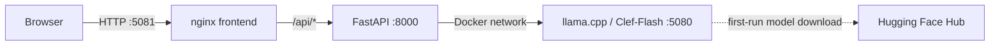

# ED Insight

**A CPU-only, Dockerized research prototype for exploring language-model support in emergency department triage workflows.** It pairs a small web interface and typed API with a locally hosted Clef-Flash GGUF model served by llama.cpp, and includes a reproducible set of synthetic clinical narratives.

> **Clinical safety:** This is a research and engineering demonstration—not a medical device, clinical decision-support product, or source of medical advice. Do not use it to make decisions about real patients. Use only fictional or properly de-identified data; never submit protected health information. All generated outputs require independent expert review.

## What it demonstrates

- A container-only, CPU inference workflow: browser UI → FastAPI → CPU-built llama.cpp/Clef-Flash.
- Two separate model tasks: disposition assessment and an **ESI-oriented acuity estimate** (1 = most urgent, 5 = least urgent).
- Input validation, bounded report size, same-origin API routing, and useful upstream timeout/error responses.
- A deterministic synthetic-case generator with configurable count, seed, and output directory.
- A small contract-test suite for request validation, triage scale, and synthetic fixtures.

The ESI estimate is an experimental model output, not an implementation or validation of the Emergency Severity Index. It is not a prediction of waiting time.

## Architecture



| Component | Responsibility | Host default |
|---|---|---:|
| `web/` | Responsive single-page interface; nginx proxies `/api/` | `5081` |
| `backend/` | FastAPI request validation and inference-service adapter | `5001` |
| `clef-server/` | Builds the patched llama.cpp server and downloads the GGUF model | internal |

## Pinned versions

| Component | Pin |
|---|---|
| FastAPI backend | Direct pins in [backend requirements](backend/requirements.txt), full Python 3.11 resolution in [backend lock](backend/requirements.lock) |
| Model downloader | Direct pin in [clef-server requirements](clef-server/requirements.txt), full Python 3.10 resolution in [clef-server lock](clef-server/requirements.lock) |
| Model snapshots | Hugging Face commit revisions pinned in the download code |
| llama.cpp | Pull request revision `16d2e01131a07355b1e16086d9d4b76cd35fbb7c` |
| Container bases | OCI digests pinned in the Dockerfiles and Compose file |
| CI actions | Immutable commit references with release tags documented in the workflow |

Direct Python dependencies, the backend and model-downloader transitive Python resolutions, container images, CI actions, llama.cpp source, and model snapshots are pinned. Ubuntu system packages are not a complete hash-locked supply-chain snapshot.

## Run with Docker Compose

Requirements: Docker Desktop (or Docker Engine) with Compose v2, internet access on first build/start, and sufficient disk/RAM for the model and CPU inference. Startup builds llama.cpp with CUDA, Metal, and Vulkan backends disabled, then downloads the GGUF model; the download is persisted in the `clef-models` volume. Inference uses CPU only; no host-side Python installation, GPU driver, or accelerator runtime is required.

```bash
cp .env.example .env
docker compose up --build
```

Open the UI at <http://localhost:5081>. The API is also available locally at <http://localhost:5001>; interactive API documentation is at <http://localhost:5001/docs>. The model server stays on the private Compose network. Host bindings use loopback by default because this demo has no authentication. Stop the stack with `docker compose down`; add `-v` only if you intentionally want to delete the downloaded model volume.

Published ports and the CPU thread count can be changed in `.env` (`LLAMA_THREADS`, default `10`). The health endpoint reports the model identifier that matches the current GGUF download configuration in `clef-server/download-model.sh`.

## API

The browser uses same-origin routes through nginx. Direct local API access is available on port `5001`.

| Method | Route | Purpose |
|---|---|---|
| `GET` | `/health` | Lightweight API health response and configured model identifier |
| `POST` | `/api/discharge` | Disposition, severity, and risk-factor model output |
| `POST` | `/api/priority` | ESI-oriented triage, category, and resource-needs output |
| `GET` | `/api/examples/search` | Case-insensitive keyword search across the `examples/` directory |
| `GET` | `/api/examples/file` | Full content of an example file by relative path |

Both POST routes accept JSON containing a non-empty `report` string up to 40,000 characters. For example:

```json
{"report":"Fictional, de-identified emergency department narrative..."}
```

Both POST routes also accept an optional `simple` query parameter (`?simple=true`) that asks the model a single question — disposition or ESI priority — instead of the full question set. The search route takes a `q` query parameter (1–200 characters); the file route takes a `path` query parameter restricted to files under `examples/`.

Successful responses are the upstream model's JSON. Invalid input returns `422`; inference timeouts return `504`; unavailable or failing inference services return `502`. The model output is intentionally not presented as a validated clinical score.

Full API documentation with response schemas and field descriptions: [backend/API.md](backend/API.md)

## Synthetic examples

`examples/cases/` contains 200 **fictional, generated** narratives spanning five intended acuity levels and multiple documentation styles. They are fixtures for software experimentation—not real records, a representative clinical dataset, or ground truth. Their labels are generated metadata, not expert-validated outcomes.

Regenerate examples reproducibly without removing unrelated files:

```bash
python3 scripts/generate_examples.py --count 200 --seed 42
```

Use `--output-dir /tmp/ed-insight-cases` to keep generated output outside the repository. The generator overwrites only files with names it generates; it does not clean the destination directory.

## Development and checks

Run the tests from the repository root with the backend lock installed:

```bash
python -m pip install -r backend/requirements.lock
python -m unittest discover -s tests -v
```

Lint with ruff (pinned in the development requirements):

```bash
python -m pip install -r requirements-dev.txt
python -m ruff check backend scripts tests
```

Run the example generator in a temporary directory to inspect output without changing checked-in examples:

```bash
python3 scripts/generate_examples.py --count 5 --output-dir /tmp/ed-insight-cases
```

FastAPI's OpenAPI schema is available at `/openapi.json`; Swagger UI is at `/docs` when running the backend.

## Repository map

```text
backend/       FastAPI service and container image
clef-server/   CPU llama.cpp build, model download, and startup scripts
examples/      Synthetic narrative fixtures
scripts/      Reproducible synthetic-case generator
tests/        Request and triage-scale contract tests
web/          Responsive UI and nginx reverse-proxy configuration
```

## Safety, privacy, and licensing

This repository has not been clinically validated and does not establish safety, effectiveness, fairness, calibration, or regulatory status. The ESI label in this demo does not imply endorsement or affiliation with the ESI authors or rights holders. Do not deploy this prototype in a care environment.

The application sends report text to the model service configured for the deployment. This local Compose setup does not intentionally call a hosted inference API, but deployments, logs, model downloads, and infrastructure may have different data flows. Never enter identifiable patient data unless the entire environment has been formally approved for that use.

The repository code is licensed under [MIT](LICENSE). That license does not cover Clef-Flash model weights, llama.cpp, third-party dependencies, trademarks, or other external artifacts; review their separate licenses and terms before use. The software is provided without warranty and the clinical-safety restrictions above still apply.
